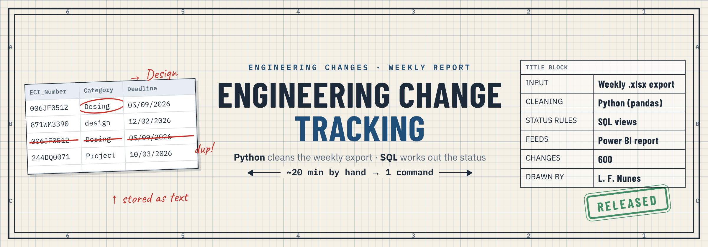
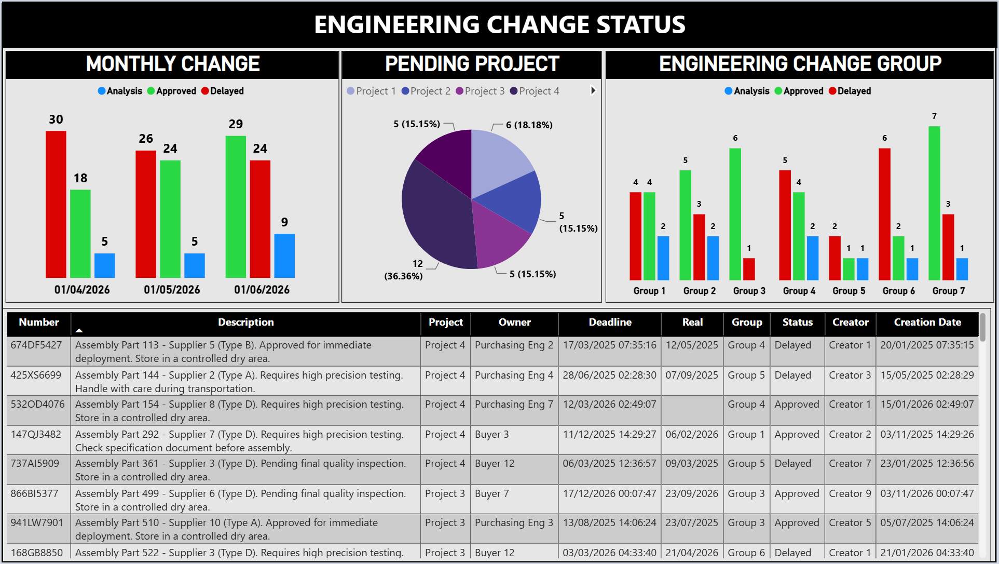
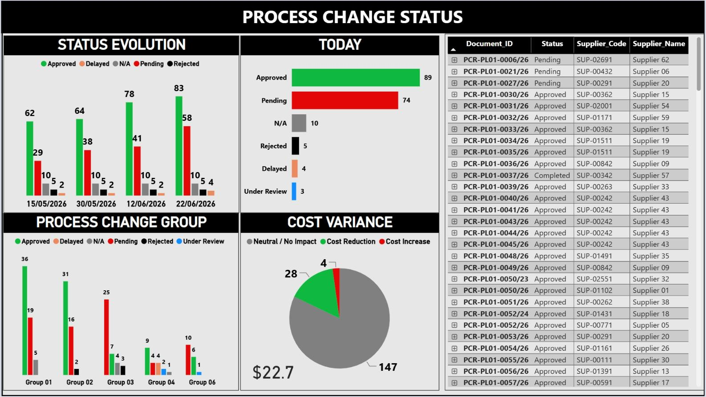

# Engineering Change Tracking



Two Power BI dashboards that show a manufacturing plant which engineering changes are late, whether things are getting better, and which team is holding them up.

| | |
|---|---|
| **Problem** | The company system only showed the status of each change right now. There was no history, and the weekly report took about 20 minutes of copy, paste and formulas. |
| **Where** | Engineering change reporting at a manufacturing company. |
| **Solution** | Two Power BI dashboards, and a step that cleans the weekly export and works out the status of every change, week by week. |
| **Result** | The weekly meeting goes straight to the team that is behind and its list of late changes. The weekly report takes one command instead of 20 minutes. |
| **Tools** | Power BI · DAX · Power Query · Excel · Python (pandas) · SQL |

---

## The problem

When a product design changes, the change needs approval from several teams before a deadline. The company system showed only the status of each change **right now**. It kept no history, so nobody could answer what people asked in the weekly meeting:

- How many changes were late last month?
- Is it getting better or worse?
- Which team is holding things up?

## The dashboards

The dashboards used at work, shown with fake data (names, suppliers, projects).

**Engineering changes (ECI).** Status of each change (approved, late or still under analysis), the monthly trend, changes by team, and the list of changes with owner and deadline. Clicking a team filters the whole page: find the team that is behind, read its list, move on.



**Process changes (PCR).** Connected straight to the company system. It shows how the status changed over time, the changes by group, whether each change raises or lowers cost, and the full list.



## How the data gets there

The first dashboard depended on a spreadsheet updated by hand every Monday. This repository does that step automatically, with fake data:

```
Weekly Excel export  →  Python cleans it  →  SQL works out the status  →  CSV files for Power BI
```

1. **Excel.** `scripts/generate_data.py` creates a fake weekly export with the same kind of mistakes as the real one.
2. **Python.** `scripts/load_to_sql.py` reads it with pandas and fixes:
   - dates stored as text (`05/09/2026`), read day first
   - the same category written in different ways (`Design`, `design`, `Desing`)
   - rows exported twice
3. **SQL.** The clean table goes into a SQLite database. `sql/views.sql` has the status rule in one place:
   - **Approved:** the change has a closed date
   - **Delayed:** still open and the deadline has passed
   - **Analysis:** still open and inside the deadline

   Using the same rule on every past Monday rebuilds the history the system never kept.
4. **Power BI.** Each view is saved as a CSV in `output/`, ready for Power BI.

## Results (fake data, export of 30 Oct 2026)

| | |
|---|---|
| Rows in the export | 612 |
| Rows exported twice, removed | 12 |
| Changes after cleaning | 600 |
| Category spellings | 5 → 2 |
| Status today | 495 approved · 44 delayed · 61 under analysis |
| Team with the most delayed changes | Group 5 (13) |
| History rebuilt | 42 weeks |

## Files

| Folder | What is in it |
|---|---|
| `data/` | The fake weekly export |
| `scripts/` | `generate_data.py` (creates the export) and `load_to_sql.py` (cleans and loads SQL) |
| `sql/` | `views.sql`, the status rule and the weekly history |
| `output/` | The CSV files Power BI reads |
| `docs/` | Images |

To run it:

```bash
pip install -r requirements.txt
python scripts/load_to_sql.py
```

## Background

Based on my work on engineering change reporting at a manufacturing company. The dashboards were built and used there; the data shown here is synthetic.

---

Lucas Fernandes Nunes · [Portfolio](https://lucasnunesf.notion.site/Lucas-Nunes-Data-BI-Analyst-3de917c89c178092885cf639b619767b) · [GitHub](https://github.com/lucasnunesf)
