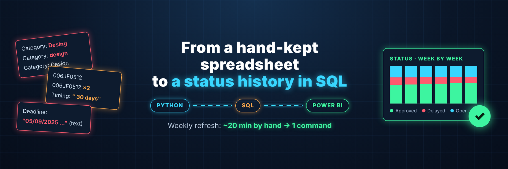
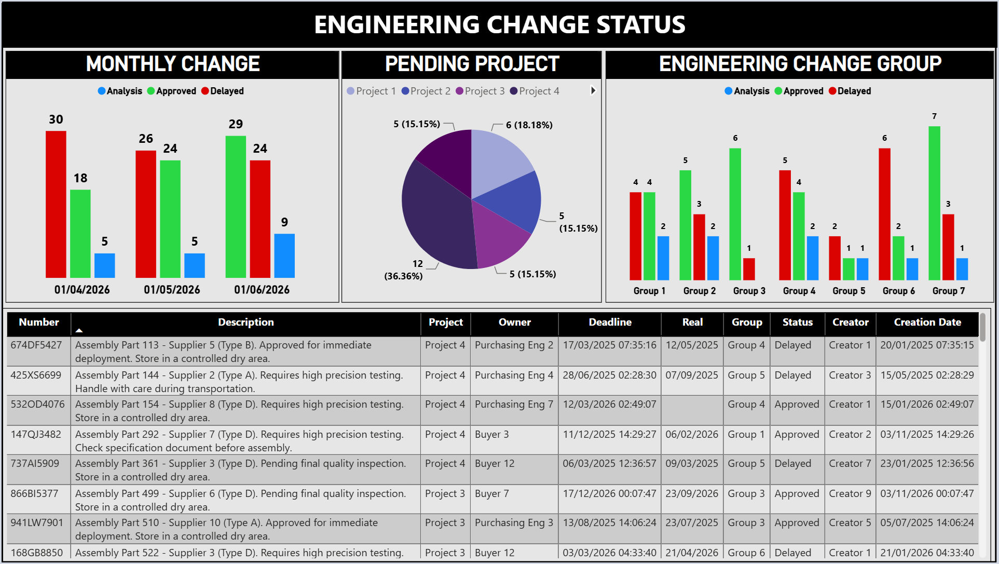
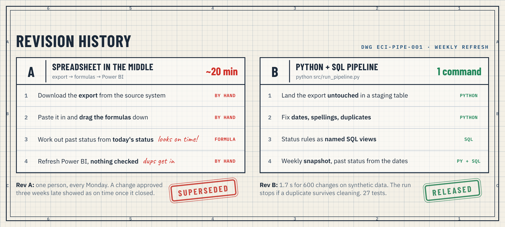
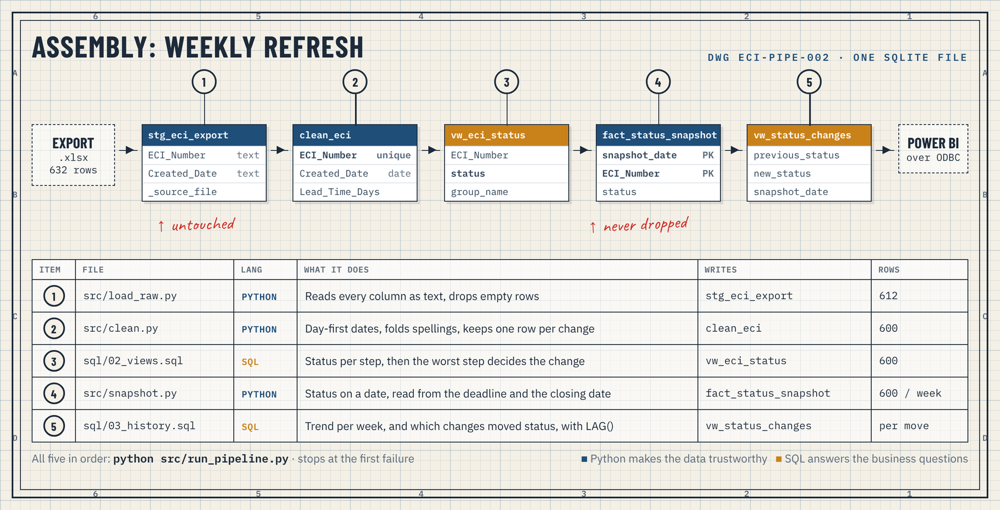
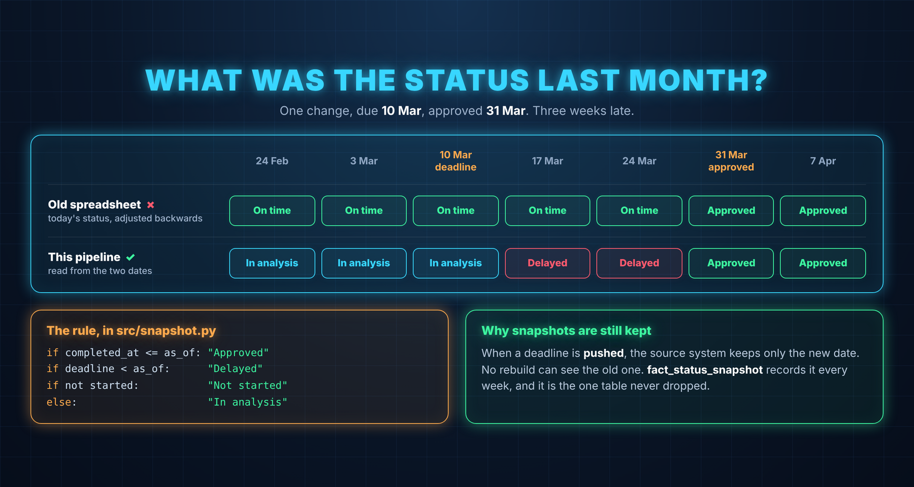

# Engineering Change Pipeline

Python and SQL pipeline that turns a messy weekly export of engineering changes into clean tables and a week-by-week status history, for a Power BI report I built at a manufacturing company.




[](https://github.com/lucasnunesf/pipeline-eng-change-powerbi/actions/workflows/tests.yml)

### At a glance

| | |
|---|---|
| **Result** | Replaces ~20 min of weekly copy, paste and formulas with one command (1.7 s for 600 changes, on synthetic data). Past status is now read from the dates, so a change approved late no longer shows up as on time. |
| **My role** | I built the Power BI report at a manufacturing company and ran its weekly refresh by hand. I designed and wrote this pipeline on my own, afterwards, to fix what the spreadsheet in the middle got wrong. |
| **In this repo** | 6 Python scripts, 3 SQL files, a synthetic data generator, 27 tests and a CI workflow. |
| **Skills** | SQL (views, CTE, window functions) · Python · pandas · ETL · data cleaning · data quality checks · snapshot fact table · SQLite · pytest · GitHub Actions · Power BI |
| **Full case** | [Power BI: Engineering Change Tracking](https://lucasnunesf.notion.site/Power-BI-Engineering-Change-Tracking-3e5917c89c1780978911c01acd0b21b3) (both dashboards, with recordings) |

> **Why synthetic data.** The real export belongs to the company. `src/generate_raw.py` builds one with the same columns and the same defects, so the whole pipeline runs on a fresh clone with nothing to download. The pipeline is a rebuild done for this portfolio. It did not run in production there.

---

## Results

| | Spreadsheet version | This pipeline |
|---|---|---|
| Weekly refresh | ~20 min by hand | `python src/run_pipeline.py`, 1.7 s |
| Status on a past date | today's status, adjusted backwards | read from the deadline and the closing date |
| History | none, rebuilt each time | one row per change per week, never dropped |
| Duplicate rows | reached the report | 12 removed; the run fails if one survives |
| Category spellings | 6 ways to write 3 values | 3 |
| Dates | text in some rows, dates in others | parsed once, day-first |
| Business rules | nested `IF` in a hidden column | SQL views anyone can read |

The report it feeds, rebuilt on synthetic data:



---

## The problem

The source system tracks engineering change instructions (ECI: a formal request to change a part or process) through a two-step approval: buyer, then engineering purchasing. It shows the status *right now* well. It cannot say what the status was last month, because it keeps no history.



The spreadsheet that filled the gap had three faults:

1. **The export was manual.** About twenty minutes every Monday.
2. **The history was wrong.** It took today's status and adjusted it backwards, so a change approved three weeks late looked on time once it closed. One branch of the formula never ran, because of a typo in a status name.
3. **Nothing checked the data.** Duplicates, `Design` / `design` / `Desing`, and dates stored as text all went straight into the report.

---

## How it works



| Step | Script | Language | What it does | Writes |
|---|---|---|---|---|
| 1 | `load_raw.py` | Python | Reads every column as text, drops empty rows, adds file name and load time | `stg_eci_export` |
| 2 | `clean.py` | Python | Day-first dates, trims text, folds spellings, keeps the newest copy of each change | `clean_eci` |
| 3 | `sql/02_views.sql` | SQL | Status per step, then one status per change (the worst step wins) | `vw_eci_status` and 5 more views |
| 4 | `snapshot.py` | Python | Status of every change on a date, read from its dates | `fact_status_snapshot` |
| 5 | `sql/03_history.sql` | SQL | Trend per week, and which changes moved status (`LAG()`) | `vw_status_history`, `vw_status_changes` |

`run_pipeline.py` runs them in order and stops at the first failure. Power BI reads the views over ODBC.

### The hard part: the status on a past date



The status rule:

| Step state | Status |
|---|---|
| Closed (code 2 or 3) | Approved |
| Open, deadline passed | Delayed |
| Open, deadline ahead | In analysis |
| Not started (code 1) | Not started |

A change takes the worst status of its two steps. One late step makes the whole change late. Every change lands in exactly one status, so the totals always add up. The spreadsheet sent codes 1 and 2 to "N/A", which hid most of the records.

---

## Design decisions

**Python cleans, SQL decides.** Python is good at reading a messy file and fixing types. SQL keeps the rules readable for someone who does not write Python. Changing what "late" means is one `CASE` in `sql/02_views.sql`.

**Past status comes from the dates, not from today's status.** The same date always gives the same answer, whenever the pipeline runs.

**Snapshots are still kept.** When a deadline is pushed, the source system keeps only the new one, and no rebuild can see the old date. `fact_status_snapshot` is created with `IF NOT EXISTS` and is the only table never dropped. Its key is `(snapshot_date, ECI_Number)`, so running twice on one date replaces it instead of doubling it.

**The raw table is never touched.** If a cleaning rule turns out wrong, it is fixed and re-run against `stg_eci_export` without downloading the export again.

**Unmapped values are kept.** A new category spelling passes through as it arrived and shows up in the run summary. A pipeline that quietly drops rows is harder to trust than one that complains.

**No data in Git.** `.gitignore` blocks `*.xlsx`, `*.db` and `*.pbix`. The repository holds what produces the data, so a clone builds the same database.

---

## Try it

```bash
git clone https://github.com/lucasnunesf/pipeline-eng-change-powerbi
cd pipeline-eng-change-powerbi
pip install -r requirements.txt

python src/run_pipeline.py --fresh
```

`--fresh` builds the database from nothing and writes 12 weeks of history, so the trend views have data from the first run. Real output, cut to the important lines (the dates depend on the day you run it, the counts do not):

```
1/5  generate the export
  632 rows (600 unique ECIs)

2/5  load it into the staging table
612 rows left after dropping empty ones

3/5  clean and deduplicate
Distinct values, before -> after
  Category           6 ->   3
  Change_Type        5 ->   3
  Timing             6 ->   5
  Created_By        20 ->  10
Duplicates: 12 rows removed, 600 documents left

5/5  seed 12 weeks of history
2026-08-18   600 documents  {'Approved': 240, 'Not started': 159, 'Delayed': 122, 'In analysis': 79}
...
2026-11-03   600 documents  {'Approved': 271, 'Not started': 172, 'Delayed': 125, 'In analysis': 32}
fact_status_snapshot now holds 7,200 rows, from 2026-08-18 to 2026-11-03

Pipeline finished in 1.7s
data/eci.db is 932 KB and ready for Power BI
```

After that, the weekly run is `python src/run_pipeline.py`. It adds one week to the history and keeps the old ones.

What the report reads:

| View | Holds |
|---|---|
| `vw_eci_status` | one row per change, with its current status |
| `vw_status_by_group` | count per group and status |
| `vw_status_by_vehicle` | count per vehicle and status |
| `vw_on_time_by_step` | on-time rate per step (about 65% for both, on synthetic data) |
| `vw_status_history` | status mix on each snapshot date |
| `vw_status_changes` | which changes moved status, and from what |
| `vw_weekly_movement` | count of those moves per week |

---

## Tests

```bash
pytest
```

27 tests, run by GitHub Actions on every push:

| Level | File | Checks |
|---|---|---|
| Unit | `test_clean.py` | day-first dates, spelling folds, unmapped values kept, newest duplicate kept |
| Business rules | `test_rules.py` | each status case, the worst step wins, the SQL views give the same four statuses, the snapshot table survives a rebuild |
| Data | `test_generator.py` | the synthetic export has the planned defects and nothing impossible |
| End to end | `test_pipeline.py` | runs the scripts in an empty folder: row counts per layer, weekly runs add history, a repeated snapshot does not double, Python and SQL agree on today's status |

Writing the tests turned up two real bugs, both fixed:

- **Steps closed in the future.** The generator wrote 57 closing dates after the day the export was taken. SQL counted those steps as approved, Python as still open, so the report and the history disagreed. A step that has not closed yet is now written as still open, and the export is dated the day it runs, so the 12 weeks of history show real movement.
- **Two clocks.** Python used local time and SQLite used UTC (`DATE('now')`). Between 9 pm and midnight in Brazil, the report and the snapshot disagreed about what was late. The SQL now uses `DATE('now', 'localtime')`.

<details>
<summary><b>Project structure</b></summary>

```
src/generate_raw.py    builds the synthetic export, defects included
src/load_raw.py        loads it into the staging table, unchanged
src/clean.py           parsing, spelling, deduplication
src/build_sql.py       runs the .sql files in name order
src/snapshot.py        one row per change per date
src/run_pipeline.py    the order, stops on the first failure

sql/01_dimension.sql   status and step lookup tables
sql/02_views.sql       the status rules and the reporting views
sql/03_history.sql     the snapshot table and the trend views

tests/                 pytest suite
docs/                  images used in this README
.github/workflows/     CI
```
</details>

<details>
<summary><b>Run one step at a time</b></summary>

Useful while changing a rule:

```bash
python src/generate_raw.py     # build the synthetic export
python src/load_raw.py         # land it, untouched
python src/clean.py            # clean and deduplicate
python src/build_sql.py        # run the sql files
python src/snapshot.py         # record today
python src/snapshot.py --date 2026-06-01   # or another date
```
</details>

<details>
<summary><b>Glossary</b></summary>

- **ECI (Engineering Change Instruction):** a formal request to change a part, drawing or process, approved step by step.
- **Buyer / Eng Purchasing:** the two approval steps, each with its own owner, deadline and closing date.
- **Snapshot:** the status of every change on one date, stored so the past can be read later.
- **Staging table:** the export loaded as it arrived, before any cleaning.
</details>

---

## Next steps

- An explicit `CREATE TABLE` for `clean_eci`, instead of letting pandas create it.
- Small CSV samples of each layer in `data/sample/`, for reading the data in the browser without cloning.

## Author

Lucas Fernandes Nunes · [Portfolio case](https://lucasnunesf.notion.site/Power-BI-Engineering-Change-Tracking-3e5917c89c1780978911c01acd0b21b3) · [GitHub](https://github.com/lucasnunesf)
